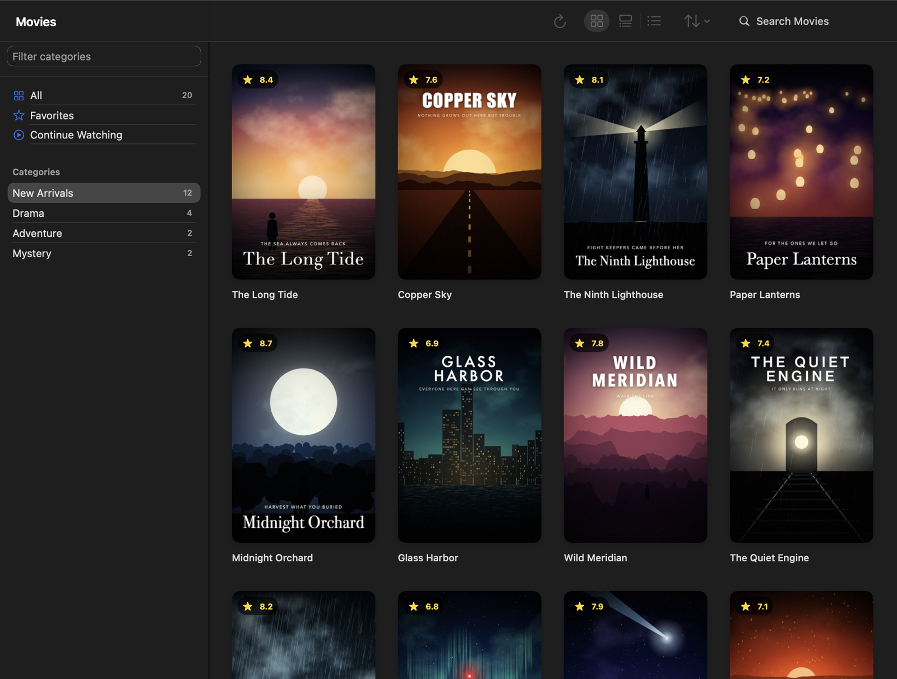
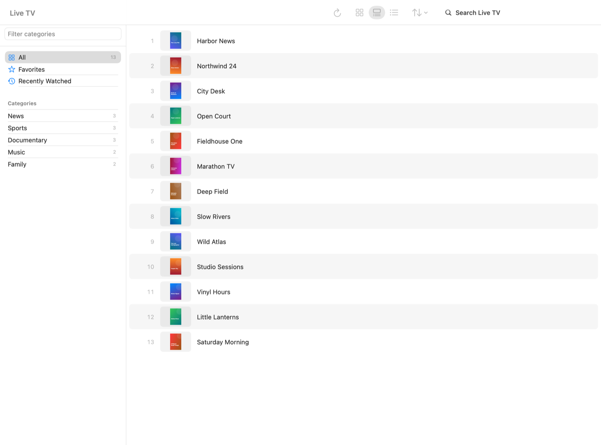
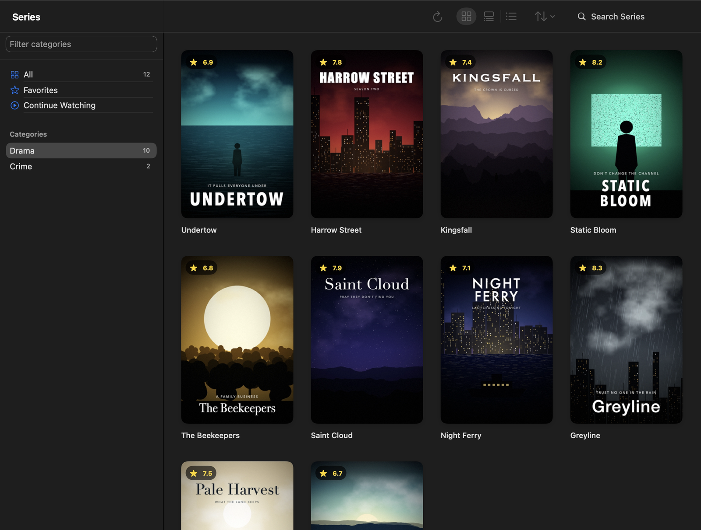
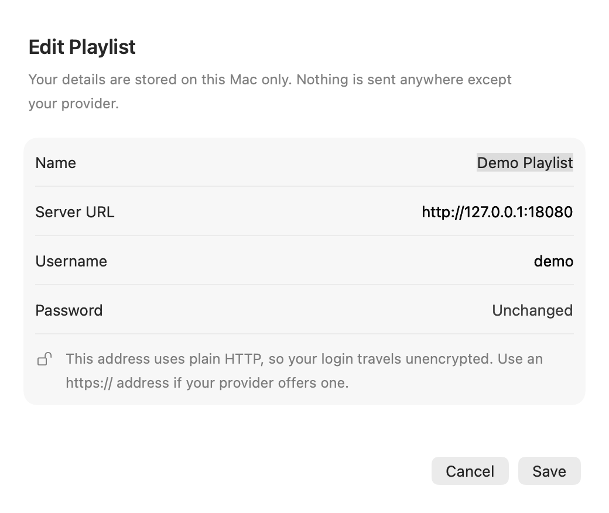

<div align="center">


# Retune

**A small, private, keyboard-driven IPTV player for the Mac.**

Free and open source. No paid tier, no accounts, no ads, no tracking.

[](https://github.com/0xAliRaza/retune/actions/workflows/ci.yml)
[](LICENSE)


[Download](#install) · [Run it locally](#run-it-locally) · [Security](#your-questions-about-security-and-privacy) · [Shortcuts](#keyboard-shortcuts)



<sub>Screenshots use made-up demo data.</sub>

</div>

> [!IMPORTANT]
> **Retune is only a player.** It comes with no channels, playlists, subscriptions or media, and it isn't affiliated with any provider. You bring your own legal source, and you're responsible for having the rights to what you watch.

## Why Retune exists

You already pay your IPTV provider. Paying again, every month, just for an app to open that service felt wrong to me, so I built the player I wanted and kept using it.

When my own subscription was about to end, I decided to clean it up and give it away. If you've got a provider and a Mac, you shouldn't need a second subscription to press play.

Plenty of Mac IPTV players are good, and many are worth paying for. Retune is for you if you want something smaller:

- **It's a real Mac app.** Built with SwiftUI, with hardware decoding through [mpv](https://mpv.io). Not a web page in a wrapper.
- **It keeps up with big catalogs.** Tested against a real provider with over 88,000 channels, movies and series.
- **Your hands can stay on the keyboard.** Every action has a shortcut, and flipping channels works like a TV remote.
- **It's yours.** There's no Retune server, account or analytics. Your login only goes to your provider.
- **You can read all of it.** About 7,000 lines of Swift, GPL-licensed.

## What you get

| | |
| --- | --- |
| **Sources** | Xtream Codes, M3U links and local M3U files, with several playlists side by side |
| **Live TV** | Now and Next guide on Xtream, recent channels, last-channel jump, automatic reconnection |
| **Movies and series** | Posters, plots, seasons, resume points, Continue Watching, next-episode autoplay |
| **Library** | Favorites, instant accent-insensitive search, and hide, pin or lock categories |
| **Playback** | Audio and subtitle tracks, subtitle styling and timing, speed control, screenshots, stats overlay |
| **Family** | PIN-protected categories |
| **Layouts** | Grid, list and compact views for each section |

<table>
  <tr>
    <td></td>
    <td></td>
  </tr>
</table>

Series and the Now and Next guide need an Xtream Codes login, because M3U playlists don't carry that data.

**Not here yet:** iPhone, iPad, Apple TV and Windows versions, recording, Picture in Picture, media keys, and full VoiceOver labels. Retune is a Mac app, and it will stay small.

## Install

### Download

1. Get the DMG from the [latest release](https://github.com/0xAliRaza/retune/releases/latest).
2. Open it and drag **Retune** to **Applications**.
3. Open Retune. macOS will block it the first time, because the app isn't notarized by Apple yet.
4. Go to **System Settings → Privacy & Security**, scroll down and click **Open Anyway**.

After a future update, macOS may [ask for your Mac password](#why-does-macos-ask-for-my-mac-password). That's expected. Type it and click **Always Allow**.

Each download needs **Apple Silicon** and the macOS version listed on its release, because the bundled libraries are built for that system. If your Mac doesn't match, [run it locally](#run-it-locally) instead.

Why isn't it notarized? Apple charges $99 a year for that, and this is a free project for now. If you'd rather not trust a downloaded binary, building it yourself takes a few minutes.

## Run it locally

This builds Retune from source on your own Mac, so you know exactly what you're running.

### 1. Check that you have what you need

- macOS 14 or newer, on Apple Silicon or Intel
- About 2 GB of free disk space
- [Homebrew](https://brew.sh)

### 2. Install Apple's command line tools

You don't need the full Xcode app.

```bash
xcode-select --install
```

If it says they're already installed, that's fine.

### 3. Install libmpv

This is the playback engine. It pulls in FFmpeg too, so it can take several minutes.

```bash
brew install mpv
```

### 4. Get the code

```bash
git clone https://github.com/0xAliRaza/retune.git
```

```bash
cd retune
```

### 5. Build and install

```bash
./scripts/build-app.sh --install
```

This compiles a release build and puts `Retune.app` in `/Applications`. Open it like any other app.

To build without installing, leave off `--install`, and the app lands in `build/Retune.app`.

> [!NOTE]
> **Expect a password popup after rebuilding.** Your first build won't ask, but macOS treats each rebuild as a new app, so it asks for your Mac password before handing over your saved login. This is normal. [Here's why](#why-does-macos-ask-for-my-mac-password).

### Running it for development

```bash
swift run Retune
```

```bash
./scripts/test.sh
```

Use `./scripts/test.sh` rather than `swift test`. It also works when you only have the command line tools.

### Updating

```bash
git pull && ./scripts/build-app.sh --install
```

A local build links your Homebrew libmpv, so keep `mpv` installed. macOS asks for your Mac password again after each rebuild, because the Keychain ties access to the app's exact signature. Click **Always Allow** and it stays quiet until the next rebuild.

### Making your own DMG

```bash
brew install dylibbundler
```

```bash
./scripts/package.sh
```

This produces a self-contained app and DMG in `build/`.

### If the build fails

| Message | Fix |
| --- | --- |
| `mpv/client.h file not found` | Run `brew install mpv`, then try again. |
| `no such module 'Testing'` | Use `./scripts/test.sh` instead of `swift test`. |
| Odd errors after moving the folder | Run `swift package clean`, then rebuild. |
| `xcrun: error: invalid active developer path` | Run `xcode-select --install`. |
| The app opens, then quits immediately | Run `brew upgrade mpv`, then rebuild. |

## Getting started

1. Open Retune and click **Add Playlist**.
2. Choose how you connect:
   - **Xtream Codes:** enter your server, username and password. Pasting a full `get.php` link into the server field fills in all three.
   - **M3U URL:** paste your playlist link.
   - **M3U File:** choose a `.m3u` or `.m3u8` file.
3. Wait for the first catalog download. After that, Retune opens instantly and refreshes in the background.

> [!NOTE]
> **Don't be alarmed by a password popup.** You won't see one on a fresh install, but after an update macOS may say Retune wants to use confidential information in your Keychain, and ask for your login keychain password. That's your normal Mac password. Type it and click **Always Allow**. It goes to macOS, not to Retune. [Here's why it happens](#why-does-macos-ask-for-my-mac-password).

## Your questions about security and privacy

You're giving an app your login and pointing it at the internet, so these are fair things to ask. Here are straight answers, including the parts that aren't perfect.

### Where does my password go?

Into the **macOS Keychain**, the same place Safari keeps passwords. It's never written to a Retune file, never logged, and only sent to the server you entered.

M3U links are different. A provider's M3U link often has your password inside it, and Retune stores that link in a local file, because a link isn't a login field it can separate out. The file is readable only by your macOS user, but it isn't encrypted.

### Why does macOS ask for my Mac password?

Because your provider password is locked in the Keychain, and macOS is checking that you're happy for this version of Retune to read it. A fresh install doesn't ask, because an app can read back what it saved itself. You'll see it after an update, and it comes from macOS itself:

- **Retune never sees your Mac password.** You're typing into a macOS system dialog, and the app only gets a yes or no.
- **"Login keychain password" just means your Mac password,** unless you've deliberately changed it.
- **Always Allow** stops the popup until Retune next changes. **Allow** works for this one time. **Deny** is safe too, but Retune won't be able to log in until you allow it or enter your provider password again.

The Keychain is what well-built Mac apps use to store passwords. You rarely see this popup from them because they're signed with a paid Apple Developer ID, which gives every version the same identity. Retune doesn't have one yet, so macOS ties the permission to the exact build, and each update looks like a new app.

Only ever type your Mac password into this kind of system dialog. If something inside the Retune window itself asks for it, don't enter it, and please [report it](SECURITY.md).

### Is my login sent securely?

**That depends on your provider, and often it isn't.** The Xtream Codes system puts your username and password directly in web addresses, and most providers only offer plain HTTP. On plain HTTP, anyone on the network path, such as a shared Wi-Fi network, could read your login and see what you're watching.

Retune can't fix that, but it won't hide it. It warns you when you enter a plain HTTP address, and it uses HTTPS whenever your provider supports it. A VPN you trust protects the part between you and the VPN.



For this reason, don't reuse your IPTV password anywhere else.

### Does Retune track me or phone home?

No. There's no analytics, crash reporting, ads, account or update check. Retune only contacts your provider, plus the artwork hosts your playlist points to. Those hosts can see your IP address when posters load, as with any image on the web.

You don't have to take my word for it: search the code, or watch the app's traffic in a tool like [Little Snitch](https://www.obdev.at/products/littlesnitch/).

### Can a bad playlist harm my Mac?

Retune treats every playlist, server response, image and stream as hostile:

- Only network streaming addresses reach the player. That blocks mpv's special addresses, which could otherwise read or overwrite local files. A real version of this bug was found and fixed before release.
- mpv's scripting and yt-dlp support are off.
- Downloads have size limits and timeouts, and odd dates and durations are bounds-checked.

No software can promise perfection. Video decoders are complex, and Retune doesn't use the App Sandbox yet, so a serious bug in mpv or FFmpeg could reach your files. Stay on the latest release, and keep `mpv` updated if you built from source.

### What's stored on my Mac?

Everything is in `~/Library/Application Support/Retune`, private to your macOS user:

| File | Contents |
| --- | --- |
| `playlists.json` | Playlist names and server addresses, and M3U links |
| `Catalogs/` | Cached channel, movie and series lists |
| `library.json` | Favorites, watch progress and hidden categories |

Watch history stores anonymous references rather than stream addresses, so your password doesn't end up there. These files aren't encrypted, so they're included in unencrypted backups.

### Is the app safe to open if it's not notarized?

Notarization means Apple scanned a build. It doesn't mean a security review. Still, I understand if you'd rather be careful. You can check the DMG's published checksum, or better, [build it yourself](#run-it-locally).

### How strong is the parental PIN?

It's enough to stop a child, not a determined adult. The PIN is stored as a salted PBKDF2 hash, but a short PIN can be guessed by anyone with access to your macOS account.

### Is this legal?

The player is. IPTV is just a way of delivering video, and plenty of it is legitimate. What you stream through it is your responsibility. Retune doesn't provide or recommend sources, and issues asking for them will be closed.

### Was this built with AI?

Yes, heavily. I'll tell you exactly what that means [below](#how-this-was-built).

### How do I delete everything?

1. Quit Retune and drag it from Applications to the Trash.
2. Remove its data:

```bash
rm -rf ~/Library/Application\ Support/Retune ~/Library/Caches/Retune ~/Library/Caches/io.github.0xaliraza.retune ~/Library/HTTPStorages/io.github.0xaliraza.retune
```

```bash
defaults delete io.github.0xaliraza.retune
```

3. Open **Keychain Access**, search for `retune`, and delete its entries.

[SECURITY.md](SECURITY.md) has the full threat model, known limitations and how to report a vulnerability privately.

## Keyboard shortcuts

Press `?` in the app to see these anytime.

### Player

| Keys | Action |
| --- | --- |
| `Space` | Play or pause |
| `←` `→` | Back or forward 10 seconds |
| `⇧←` `⇧→` | Back or forward 60 seconds |
| `↑` `↓`, `Page Up` `Page Down` | Previous or next channel, movie or episode |
| `N` `⇧N` | Next or previous |
| `⌫` | Last watched channel |
| `L` | Channel or up-next list |
| `[` `]` `\` | Slower, faster, normal speed |
| `-` `=` | Volume down or up |
| `M` | Mute |
| `C` | Subtitles on or off |
| `F` | Full screen (or double-click) |
| `I` | Stats |
| `S` | Screenshot to Desktop |
| `Esc` | Close panel, back to browsing |

### Browsing

| Keys | Action |
| --- | --- |
| `⌘1` `⌘2` `⌘3` | Live TV, Movies, Series |
| `⌃⌘1` `⌃⌘2` `⌃⌘3` | Grid, list, compact layout |
| `⇥` `⇧⇥` | Next or previous column |
| Arrow keys, `Return` | Move around, open or play |
| `⌘[` | Back |
| `⌘F` | Search |
| `⌘R` | Refresh playlist |
| `⇧⌘N` | Add playlist |
| `⌘L` | Lock categories again |

## Troubleshooting

| Problem | What to try |
| --- | --- |
| A channel won't start | Your plan may be at its connection limit. Stop playback on other devices and retry. |
| Audio or video stutters | In **Settings**, change the live stream format to HLS, which copes better with weak connections. |
| A channel has no sound | Retune shows a notice when the stream has no audio track. That's a provider issue. |
| A live channel jumps back after a dropout | Retune reconnects when a stream drops. If your provider's backup server is behind, it sends older video, and no player can avoid that. |
| "Saved password is missing" | Keychain access was denied. Edit the playlist and enter your password again. |
| macOS asks for your password after an update | [That's expected](#why-does-macos-ask-for-my-mac-password). Enter your Mac login password and click **Always Allow**. |

Retune can't help with provider accounts or find you a source, so please keep issues about the app itself.

## How this was built

Retune began as a tool for one person, me, and it was written with heavy use of AI, chiefly [Claude Code](https://claude.com/claude-code). I think you should know that, along with what was done about the risks.

Before release, it went through:

- A security review of how it handles passwords, playlists and network data, which found and fixed real problems, including the file overwrite bug above and passwords sitting in a network cache
- Fault-injection testing of the live player, with connections cut on purpose, which found the root cause of a replay glitch
- Testing against a real provider's live TV, movies and series
- Automated tests for the core logic, with bug-fix tests proven to fail without their fix
- Secret scanning of the full git history in CI

It has **not** had an independent security audit. If you find a problem, please [report it](SECURITY.md), and I'll fix it.

## Contributing

Bug reports and pull requests are welcome. See [CONTRIBUTING.md](CONTRIBUTING.md). If you're using an AI coding tool, point it at [AGENTS.md](AGENTS.md), which has the architecture and project rules.

```text
Sources/CMPV        libmpv bindings
Sources/RetuneCore  Provider API, parsing, library state and storage (no UI, fully testable)
Sources/Retune      SwiftUI app and the mpv player
Tests               Unit tests for RetuneCore
scripts             Build, test and packaging
```

## License

Retune is free software under the [GNU General Public License v3.0 or later](LICENSE). See [THIRD_PARTY_NOTICES.md](THIRD_PARTY_NOTICES.md) for the libraries bundled in the packaged app.

Retune stands on [mpv](https://mpv.io) and [FFmpeg](https://ffmpeg.org), which do the hard work.
